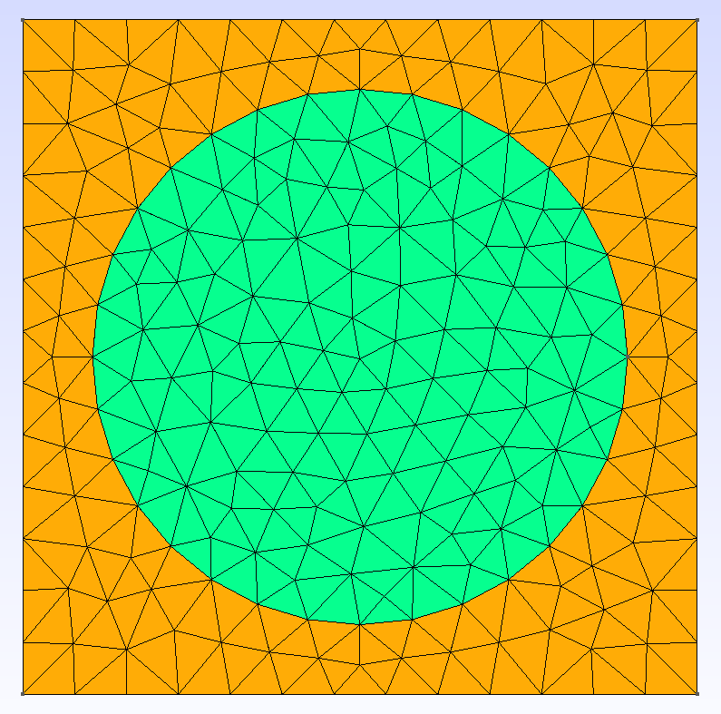

===========
Quick Start
===========

This tutorial demonstrates how to construct a simple nuclear fuel
pin-cell geometry, generate an unstructured mesh using UM2, and
export the mesh to a Gmsh file.

The example uses UM2's OpenMC-compatible Python API and does not
require an OpenMC cross-section library or an MPACT installation.

Prerequisites
-------------

Before starting, install UM2 and its Python bindings as described
in :doc:`installation`.

The following example requires the ``um2`` and ``gmsh`` Python
packages, including the compiled UM2 extension.

Creating a Pin-Cell Model
-------------------------

We will create a two-dimensional model containing a circular
fuel region surrounded by a square water moderator region.

The fuel region has a radius of 0.5 cm, and the square has
a width and height of 1.26 cm.

Create a Python file named ``quickstart.py`` and add:

.. code-block:: python

   from pathlib import Path

   import gmsh
   import um2
   import um2.openmc as openmc

   # Define materials.
   fuel = openmc.Material(name="fuel")
   fuel.add_nuclide("U235", 1.0)
   fuel.set_density("g/cc", 10.0)

   water = openmc.Material(name="water")
   water.add_nuclide("H1", 2.0)
   water.add_nuclide("O16", 1.0)
   water.set_density("g/cc", 1.0)

   # Define the fuel and outer boundaries.
   fuel_boundary = openmc.ZCylinder(r=0.5)

   outer_boundary = openmc.model.RectangularPrism(
       1.26, 1.26, boundary_type="reflective"
   )

   # Assign materials to regions.
   fuel_cell = openmc.Cell(
       fill=fuel,
       region=-fuel_boundary
   )

   water_cell = openmc.Cell(
       fill=water,
       region=+fuel_boundary & -outer_boundary
   )

   geometry = openmc.Geometry([fuel_cell, water_cell])

   # Initialize UM2.
   um2.initialize()

   try:
       # Generate a triangular mesh.
       result = um2.mesh_geometry(
           geometry,
           mesh_size=0.1,
           mesh_type="Tri",
       )

       # Export the Gmsh mesh.
       output = Path("pin.msh")
       gmsh.write(str(output))

       print("Mesh created:", output.resolve())
       print("Fine cells:", result.model.num_fine_cells_total)

   finally:
       um2.finalize()

The resulting triangular mesh is shown below.

   Triangular mesh of a circular fuel region surrounded
   by a square moderator region, generated using UM2.

Understanding the Geometry
--------------------------

The geometry is defined using surfaces, regions, and cells.

``ZCylinder``
   Defines a cylinder parallel to the z-axis. Its cross section
   is a circle in the two-dimensional model.

``RectangularPrism``
   Defines the rectangular outer boundary of the model.
   The ``reflective`` boundary type is stored in the
   OpenMC-compatible geometry.

``openmc.Cell``
   Associates a material with a region of space.

The negative half-space of the cylinder, ``-fuel_boundary``,
defines the fuel interior.

The expression ``+fuel_boundary & -outer_boundary`` defines
the portion of the moderator region outside the fuel but
inside the square.

Generating the Mesh
-------------------

The call to ``um2.mesh_geometry`` converts the geometry to a
Gmsh OpenCASCADE model, constructs the MPACT spatial hierarchy,
and generates an unstructured mesh.

In this example:

* ``mesh_type="Tri"`` selects linear triangular elements.
* ``mesh_size=0.1`` specifies the target mesh size in cm.
* The result contains a UM2 MPACT model and associated geometry
  and mesh information.

Because this example does not provide multigroup cross sections,
it uses a uniform target mesh size instead of Knudsen-number-based
mesh sizing.

Knudsen-number-based mesh generation, using ``kn_target``,
requires macroscopic multigroup cross sections.

Exporting the Mesh
------------------

The Gmsh Python API and UM2 operate on the same in-memory Gmsh model.

After mesh generation, calling:

.. code-block:: python

   gmsh.write("pin.msh")

saves the mesh in Gmsh's native mesh format.

This file can be opened with Gmsh for visualization.

The example generates the geometry and mesh but does not
perform a neutron transport calculation or export a complete
MPACT cross-section library.

Next Steps
----------

See :doc:`openmc_integration` for converting models constructed
using the real OpenMC Python package.

See :doc:`cross_sections` for multigroup cross-section handling,
and :doc:`mpact_export` for exporting models for use with MPACT.
